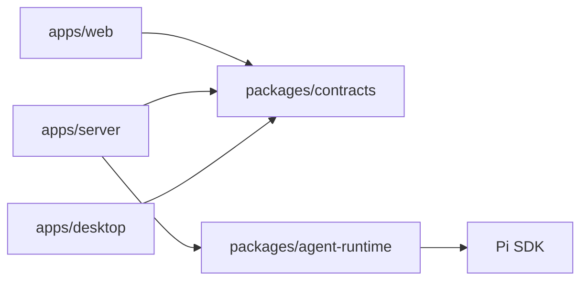
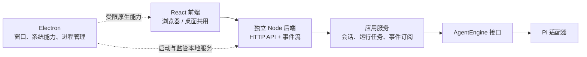

# 整体架构

应用由共享聊天前端、独立 Node 服务和 Electron 宿主组成。浏览器与桌面使用同一套 HTTP/SSE 协议；Electron 负责原生集成和本地服务进程，不承载聊天任务或 Pi 会话逻辑。

## 模块与依赖

箭头表示源码依赖。桌面通过进程和 HTTP 使用后端产物，不导入后端业务实现；它直接使用的共享契约只有 [contracts/native](../packages/contracts/src/native.ts)，桥接实现见 [preload](../apps/desktop/preload/index.ts)。

| 模块                     | 职责                                                   | 主要边界                                                     |
| ------------------------ | ------------------------------------------------------ | ------------------------------------------------------------ |
| `apps/web`               | React 界面、聊天视图状态、HTTP/SSE 客户端和平台适配    | 不导入 Node、Electron 或 Pi；平台适配屏蔽原生桥              |
| `apps/server`            | 鉴权、HTTP/SSE、会话编排、SQLite、ChatGPT OAuth 与凭证 | 不依赖 Electron、React 或 Pi 类型，通过 AgentEngine 调用模型 |
| `apps/desktop`           | 窗口和系统集成、后端监管、静态资源与 API 代理          | preload 暴露 API 基地址、主题及受限 ChatGPT 浏览器入口       |
| `packages/agent-runtime` | AgentEngine、Pi 适配、显式 mock 引擎                   | 不依赖 HTTP 协议或应用模块，不暴露 Pi 类型给应用             |
| `packages/contracts`     | HTTP 类型与校验、最小原生桥契约                        | 纯 TypeScript，无应用或运行时实现依赖                        |

后端按职责拆分文件，直接注入 Store：

- [server.ts](../apps/server/src/server.ts)：组合资源，处理鉴权、请求校验、错误状态映射和 SSE 传输。
- [ChatService](../apps/server/src/chat-service.ts)：处理会话操作、幂等提交、任务、取消和事件订阅。
- [Store](../apps/server/src/store.ts)：执行数据库操作、事务、序号更新与未完成任务恢复。
- [AgentEngine](../packages/agent-runtime/src/index.ts)：提供引擎信息、执行、上下文删除和关闭能力；取消通过 `AbortSignal`，文本增量通过 `onDelta`；HTTP 版本由服务端添加。
- [ChatGPTConnectionService](../apps/server/src/chatgpt/connection-service.ts)：连接选择、授权尝试、刷新串行化、模型目录与退出策略；[oauth.ts](../apps/server/src/chatgpt/oauth.ts) 处理 OAuth/OIDC 协议和 JWKS 验签，[storage.ts](../apps/server/src/chatgpt/storage.ts) 处理受保护的原子文件存储。Runtime 只接收应用自己的有效令牌解析接口，不持有 refresh token 或凭证存储权限。

依赖方向由根目录 [lint 配置](../.oxlintrc.json) 约束。根 Vite、TypeScript 和构建脚本是共享工具链；业务依赖由各工作区声明。

## 两种运行方式

运行时协作图：实线表示业务调用，虚线表示桌面集成。

| 模式     | 启动与配置                                                                                                             | 连接与数据                              |
| -------- | ---------------------------------------------------------------------------------------------------------------------- | --------------------------------------- |
| 独立 Web | [独立入口](../apps/server/src/cli.ts) 读取工作目录的 `.env`                                                            | 回环地址，默认数据目录 `.data/`         |
| 桌面     | [主进程](../apps/desktop/main/backend.ts) 生成令牌，经 IPC 向[子进程](../apps/server/src/desktop-child.ts)发送启动参数 | 随机回环端口，数据目录 `userData/agent` |

桌面在后端就绪后创建界面；子进程不读取工作目录的 `.env`。独立服务与桌面的数据目录分开，不自动同步。开发与安装版本的配置方式见 [README](../README.md#桌面运行)。

开发 Web 由 Vite 代理注入访问令牌；桌面由 [protocol.ts](../apps/desktop/main/protocol.ts) 提供受限静态资源和 API 转发，并注入令牌。renderer 不接触访问令牌，浏览器构建不包含令牌或模型密钥。生产 Web 部署要求见 [构建与交付](build-and-delivery.md#独立-web-部署)。

## 数据与配置归属

| 数据                                               | 负责组件                                | 含义                                         |
| -------------------------------------------------- | --------------------------------------- | -------------------------------------------- |
| 会话索引、消息投影、requestId、任务状态和 sequence | Store / SQLite                          | 提供界面历史、幂等查询与任务恢复标记         |
| 模型完整上下文                                     | Pi 适配器 / 应用专属 session 目录       | 供后续模型调用延续上下文，不能由展示消息替代 |
| 当前会话选择、Web 主题                             | 浏览器本地存储                          | 界面偏好，聊天记录仍由后端持久化             |
| 原生主题、窗口状态                                 | Electron 配置                           | 桌面宿主管理的界面偏好                       |
| API Key 模式的提供商、模型与凭证                   | 后端启动环境                            | `PI_AUTH_MODE=env`；前端不配置密钥           |
| ChatGPT 注册、令牌、目录缓存与所选模型             | 后端数据目录 `chatgpt/connections.json` | `PI_AUTH_MODE=chatgpt`；前端只接收脱敏状态   |

Pi 使用应用专属的工作目录、设置、内存凭据存储和会话目录，不加载用户全局配置、默认工具、skills 或扩展。已有展示历史而 Pi 原生上下文缺失时，继续生成会失败，需要新建会话。

ChatGPT 模式包装 Pi 的 `openai` provider，禁用环境密钥解析，由 ConnectionService 为每次模型请求提供有效令牌；Pi 仍处理完整上下文、压缩和 Responses 流。账号模型目录与 Pi 本地目录取交集，启动与 `/meta` 不请求远端。登录时使用独立临时回环监听器，不豁免业务 API 的 Bearer/Host/Origin 校验。正式 client ID 和 host ID 持久化复用，授权码仅由后端接收，ID token 通过 JWKS 验签并检查 issuer、audience、有效期和 nonce。

同一连接的刷新和写入使用单一队列，已有数据目录锁排除其他服务。调用取消只取消等待；已经开始的令牌轮换必须完成保存。磁盘保存失败时保留内存中的新令牌并先重试保存，避免再次使用旧 refresh token。退出登录先阻止新调用并取消生成，再撤销最新凭证；迟到的登录结果不会激活连接。会话连接归属在 SQLite 事务内绑定，防止已有上下文自动跨账号发送。

### 持久化与迁移

SQLite 使用 `PRAGMA user_version` 记录结构版本，[migrations.ts](../apps/server/src/migrations.ts) 按顺序追加迁移，已发布的迁移不修改。迁移与版本更新在同一事务中提交，失败回滚，拒绝打开高于当前应用支持的版本。

升级现有数据库前，通过 SQLite 生成包含已提交 WAL 数据的一致备份；新库不备份。备份只包含 SQLite，Pi 原生上下文仍独立保存。

## 生命周期与资源所有权

Pi 适配层在 SDK 导入后初始化进程级环境代理，使用 Undici 的公开 `EnvHttpProxyAgent` API，避免 SDK 依赖覆盖 Node 的代理配置。OAuth 与模型调用共用该网络策略，遵循 `HTTP_PROXY`、`HTTPS_PROXY` 和 `NO_PROXY`；在 `NO_PROXY` 中配置回环地址以保持本地请求直连。

同一数据目录只允许一个服务拥有。在打开 SQLite 和 Pi 资源之前先取得 [目录锁](../apps/server/src/ownership.ts)，避免两个服务同时修改会话或把对方的任务标成中断。

两个后端入口共用 [启动与清理逻辑](../apps/server/src/lifecycle.ts)。

会话删除先清理引擎上下文，成功后再删除 SQLite 元数据。

### 正常关闭

按顺序执行：

1. 拒绝新业务操作，关闭 OAuth 回调监听器，取消活动任务并作有界等待。
2. 等待不可取消的上下文删除完成，再持久化未完成任务的中断状态。
3. 等待在途凭证刷新保存，关闭事件订阅、HTTP 连接和 Store。
4. 关闭引擎，在引擎真正停止后释放目录锁。

父进程断开也会触发后端关闭；桌面退出会取消恢复并回收在途子进程，监管另有强制退出兜底。

### 故障与恢复

后端就绪后意外退出，桌面以有限次数的退避重启尝试恢复，稳定运行后重置恢复预算。代理在恢复期间返回 `503`，就绪后切换到新地址，不重试原请求。

异常终止后，下次打开 Store 会将遗留活动任务标为 `interrupted`，不会自动重放模型请求。

任务状态与取消的对外语义见 [状态与取消](protocol.md#状态与取消)。

## 当前取舍与未实现范围

| 方面       | 当前选择与范围                                                                                         |
| ---------- | ------------------------------------------------------------------------------------------------------ |
| 事件恢复   | 重连使用权威快照与 sequence，不维护增量历史或游标过期窗口；交互细节见 [SSE 协议](protocol.md#sse-事件) |
| 运行模式   | 尚无桌面远程服务选择或 Worker 执行隔离                                                                 |
| 工具与权限 | 当前工具禁用；会话 ACL、工具策略、系统凭据存取及附件上传/连接器尚未实现                                |

## 扩展与维护

- 新增引擎实现 AgentEngine；替换持久化实现从后端 Store 入手。
- 新增原生能力扩展最小桥接契约、preload 和平台适配。
- 新增工具在 Runtime 中实现并经过工具策略授权；工作目录本身不构成权限沙箱。

协议字段与校验以 contracts 为准，变更与测试要求见 [协议维护约定](protocol.md#维护约定)。
