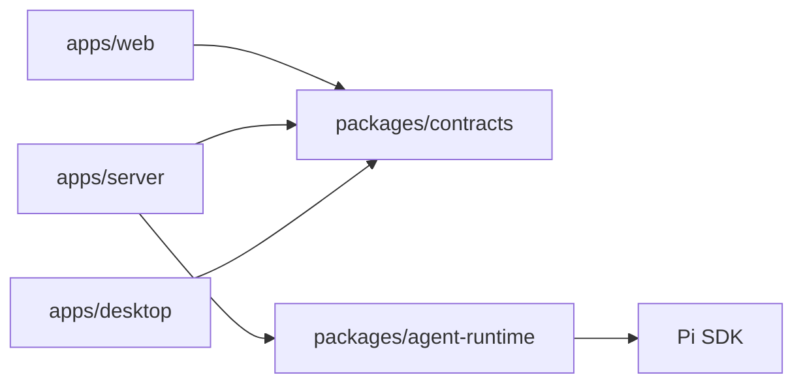
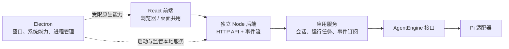

# 整体架构

应用由共享聊天前端、独立 Node 服务和 Electron 宿主组成。浏览器与桌面使用同一套 HTTP/SSE 协议；Electron 负责原生集成和本地服务进程，不承载聊天任务或 Pi 会话逻辑。启动、构建和测试命令见 [README](../README.md)，接口行为见 [前后端协议](protocol.md)。

## 模块与依赖

箭头表示源码依赖。桌面通过进程和 HTTP 使用后端产物，不导入后端业务实现；它直接使用的共享契约只有 `contracts/native`。

| 模块                     | 职责                                                | 主要边界                                            |
| ------------------------ | --------------------------------------------------- | --------------------------------------------------- |
| `apps/web`               | React 界面、聊天视图状态、HTTP/SSE 客户端和平台适配 | 不导入 Node、Electron 或 Pi；平台适配屏蔽原生桥     |
| `apps/server`            | 鉴权、HTTP/SSE、会话与任务编排、SQLite 持久化       | 不依赖 Electron 或 React，通过 AgentEngine 调用模型 |
| `apps/desktop`           | 窗口和系统集成、后端监管、静态资源与 API 代理       | preload 仅暴露 API 基地址与主题能力                 |
| `packages/agent-runtime` | AgentEngine、Pi 适配、显式 mock 引擎                | 不依赖 HTTP 协议或应用模块，不暴露 Pi 类型给应用    |
| `packages/contracts`     | HTTP 类型与校验、最小原生桥契约                     | 纯 TypeScript，无应用或运行时实现依赖               |

后端内部按实际职责划分：

- [server.ts](../apps/server/src/server.ts)：组合资源，处理鉴权、请求校验、错误状态映射和 SSE 传输。
- [ChatService](../apps/server/src/chat-service.ts)：处理会话操作、幂等提交、任务、取消和事件订阅。
- [Store](../apps/server/src/store.ts)：执行数据库操作、事务、序号更新与未完成任务恢复。
- [AgentEngine](../packages/agent-runtime/src/index.ts)：提供引擎信息、执行、上下文删除和关闭能力；HTTP 版本由服务端添加。

依赖方向由根目录 [lint 配置](../.oxlintrc.json) 约束。根 Vite、TypeScript 和构建脚本是共享工具链；业务依赖由各工作区声明。根 `package.json` 同时是 Electron 交付清单，因此保留与 desktop 一致的原生生产依赖。

## 两种运行方式

运行时协作图：实线表示业务调用，虚线表示桌面集成。

浏览器模式：[独立入口](../apps/server/src/cli.ts) 读取工作目录的 `.env`，默认使用 `127.0.0.1:4318` 和 `.data/`。Vite 代理注入访问令牌；生产环境需自行提供静态资源和带认证的反向代理，浏览器构建不包含令牌或模型密钥。

桌面模式：[backend.ts](../apps/desktop/main/backend.ts) 生成进程间访问令牌，通过 IPC 向 [桌面后端入口](../apps/server/src/desktop-child.ts) 发送启动参数，等待 ready 后创建界面。后端使用随机回环端口和 `userData/agent` 数据目录。

[protocol.ts](../apps/desktop/main/protocol.ts) 提供受限静态资源和 API 转发，并向当前后端注入令牌。[preload](../apps/desktop/preload/index.ts) 只暴露 `apiBaseUrl`、`getTheme()` 和 `setTheme()`；renderer 不接触访问令牌。

后端就绪后意外退出，桌面按 0.5、1.5、4 秒退避，最多尝试恢复三次；连续运行满 60 秒后重置预算。代理在恢复期间返回 `503`，就绪后切换到新地址，不重试原请求。退出应用会取消恢复并回收在途子进程。

开发桌面由主进程读取项目 `.env`；安装版本只继承启动环境。桌面子进程不读取工作目录的 `.env`，两个后端入口共用 [启动与清理逻辑](../apps/server/src/lifecycle.ts)。独立服务与桌面的数据目录分开，不自动同步。

## 数据与配置归属

| 数据                                               | 负责组件                          | 含义                                         |
| -------------------------------------------------- | --------------------------------- | -------------------------------------------- |
| 会话索引、消息投影、requestId、任务状态和 sequence | Store / SQLite                    | 提供界面历史、幂等查询与任务恢复标记         |
| 模型完整上下文                                     | Pi 适配器 / 应用专属 session 目录 | 供后续模型调用延续上下文，不能由展示消息替代 |
| 当前会话选择、Web 主题                             | 浏览器本地存储                    | 界面偏好，聊天记录仍由后端持久化             |
| 原生主题、窗口状态                                 | Electron 配置                     | 桌面宿主管理的界面偏好                       |
| 提供商、模型与凭证                                 | 后端启动环境                      | 前端仅读取引擎元信息与可用状态               |

Pi 使用应用专属的工作目录、设置、内存凭据存储和会话目录，不加载用户全局配置、默认工具、skills 或扩展。已有展示历史而 Pi 原生上下文缺失时，继续生成会失败，需要新建会话。

SQLite 使用 `PRAGMA user_version` 记录结构版本，[migrations.ts](../apps/server/src/migrations.ts) 按顺序追加迁移；已发布的迁移不修改。v1 保留并接管原有未标版本的表。升级现有数据库前，通过 SQLite 生成包含已提交 WAL 数据的一致备份 `app.sqlite.before-v<目标版本>.<随机标识>.bak`；新库不备份。迁移与版本更新在同一事务中提交，失败回滚，拒绝打开高于当前应用支持的版本。备份只包含 SQLite；Pi 原生上下文仍独立保存。

## 生命周期与资源所有权

同一数据目录只允许一个服务拥有。在打开 SQLite 和 Pi 资源之前先取得 [目录锁](../apps/server/src/ownership.ts)，避免两个服务同时修改会话或把对方的任务标成中断。

正常关闭按顺序执行：

1. 拒绝新业务操作，取消活动任务并作有界等待。
2. 等待在途上下文删除结算，再持久化未完成任务的中断状态。
3. 关闭事件订阅、HTTP 连接和 Store。
4. 关闭引擎，在引擎真正停止后释放目录锁。

本地文件删除不可取消，关闭会等待其完成。父进程断开也会触发后端关闭，桌面监管另有强制退出兜底。异常终止后，下次打开 Store 会将遗留活动任务标为 `interrupted`，不会自动重放模型请求；目录锁回收可能需要约 5 秒。

客户端断开只取消订阅，不取消任务。任务恢复和取消的对外语义见 [协议文档](protocol.md)。

## 构建与交付

- [build-server.mjs](../scripts/build-server.mjs) 打包工作区源码，生成独立入口、桌面入口和程序化入口；第三方生产依赖保持外置。
- [server-dependencies.mjs](../scripts/server-dependencies.mjs) 从工作区清单取得外部依赖，供构建和运行时准备共用。[prepare-runtime.mjs](../scripts/prepare-runtime.mjs) 复用根锁文件版本，为 `out/server` 通过 `npm ci` 安装依赖后用 `npm prune` 裁去其他工作区的包，并将当前 Node 二进制及其许可证放入 `out/runtime`。
- [打包配置](../electron-builder.yml) 将 Node 与自包含的 server 分别放入 `resources/runtime`、`resources/server`，位于 ASAR 外，供独立 Node 访问。后端 `node_modules` 使用单独的资源映射，避免被打包器的目录过滤规则跳过。
- 开发时由 [main 构建钩子](../electron.vite.config.ts) 监听后端、Runtime 和契约变化，先构建后端，再由 electron-vite 重启应用。桌面发布验证配套的前端、后端、Pi 与 Node 组合。

## 当前取舍与未实现范围

| 方面       | 当前选择与范围                                                                                              |
| ---------- | ----------------------------------------------------------------------------------------------------------- |
| 后端分层   | 按职责拆分文件，直接注入 Store；暂未增加应用级 Repository、CredentialStore 等接口或更多子目录               |
| 引擎边界   | 取消通过 `AbortSignal`，文本增量通过 `onDelta` 回调；外部事件订阅由 ChatService 管理                        |
| 事件恢复   | 重连使用权威快照与 sequence，不维护增量历史或游标过期窗口；交互细节见 [SSE 协议](protocol.md#sse-事件)      |
| 运行模式   | 支持独立 Web 与桌面本地服务；尚无桌面远程服务选择或 Worker 执行隔离                                         |
| 工具与权限 | 当前工具禁用；会话 ACL、工具策略、系统凭据存取及附件上传/连接器尚未实现，凭据来自后端环境                   |
| 测试方式   | Electron 使用真实本地后端与 mock 引擎验证链路，另有进程入口测试；各层测试职责见 [README](../README.md#测试) |

## 扩展与维护

- 新增引擎实现 AgentEngine；替换持久化实现从后端 Store 入手。
- 新增原生能力扩展最小桥接契约、preload 和平台适配。
- 新增工具在 Runtime 中实现并经过工具策略授权；工作目录本身不构成权限沙箱。

协议字段与校验以 contracts 为准，变更与测试要求见 [协议维护约定](protocol.md#当前范围与维护)。
