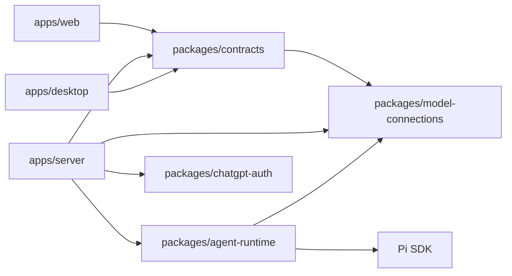
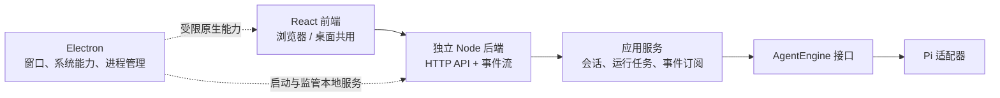

# 整体架构

应用由共享聊天前端、独立 Node 服务和 Electron 宿主组成。浏览器与桌面使用同一套 HTTP/SSE 协议；Electron 负责原生集成和本地服务进程，不承载聊天任务或 Pi 会话逻辑。

## 模块与依赖

箭头表示源码依赖。桌面通过进程和 HTTP 使用后端产物，不导入后端业务实现；它直接使用的共享契约只有 [contracts/native](../packages/contracts/src/native.ts)，桥接实现见 [preload](../apps/desktop/preload/index.ts)。

| 模块                         | 职责                                                | 主要边界                                                     |
| ---------------------------- | --------------------------------------------------- | ------------------------------------------------------------ |
| `apps/web`                   | React 界面、聊天视图状态、HTTP/SSE 客户端和平台适配 | 不导入 Node、Electron 或 Pi；平台适配屏蔽原生桥              |
| `apps/server`                | 鉴权、HTTP/SSE、会话编排、SQLite、模型与认证适配    | 不依赖 Electron、React 或 Pi 类型，通过 AgentEngine 调用模型 |
| `apps/desktop`               | 窗口和系统集成、后端监管、静态资源与 API 代理       | preload 暴露 API 基地址、主题及受限 ChatGPT 浏览器入口       |
| `packages/agent-runtime`     | AgentEngine、Pi 适配、显式 mock 引擎                | 不依赖 HTTP 协议或应用模块，不暴露 Pi 类型给应用             |
| `packages/chatgpt-auth`      | ChatGPT OAuth、账户状态、令牌刷新与撤销             | 不依赖 Pi、HTTP 契约、模型连接或应用，通过接口接收存储       |
| `packages/model-connections` | 实例配置、模型引用、执行目标与纯校验                | 无 SDK、HTTP、Node 或应用依赖                                |
| `packages/contracts`         | HTTP 类型与校验、最小原生桥契约                     | 纯 TypeScript，无应用或运行时实现依赖                        |

后端按业务能力与传输职责组织模块，根目录只保留 `cli.ts`、`desktop-child.ts`、`lifecycle.ts` 和 `server.ts` 四个启动、进程与装配入口。当前模块均为 `src` 的直接子目录，跨模块引用只通过各自的 `index.ts`；模块内部直接引用具体文件。

| 模块       | 职责                                             | 允许依赖的后端模块                            |
| ---------- | ------------------------------------------------ | --------------------------------------------- |
| 根目录入口 | 启动、实例装配、进程与资源生命周期               | `http`、`chat`、`models`、`chatgpt`、`shared` |
| `http`     | HTTP/SSE、鉴权、参数与错误映射、请求级协调       | `chat`、`models`、`chatgpt`、`shared`         |
| `chat`     | 会话、任务、事件订阅、SQLite Store 与 schema     | `models`、`shared`                            |
| `chatgpt`  | ChatGPT 应用适配与凭据文件存储                   | `models`、`shared`                            |
| `models`   | 连接配置、默认选择、模型解析与账号能力接口       | `shared`                                      |
| `shared`   | 跨模块应用错误、受保护文件、数据目录锁与有界等待 | 无                                            |

表中表示源码依赖，包含类型导入、重新导出与静态字符串动态导入。`models` 定义 `ModelAccounts`，`chatgpt` 实现该接口，装配入口注入具体实例；运行时的忙碌状态查询和退出时任务取消仍通过既有回调协调。共享能力不依赖业务模块，业务模块不反向引用根目录入口。新增模块目录需显式登记依赖规则。

错误类型按职责归属：[ChatError](../apps/server/src/chat/errors.ts) 由 `chat` 定义并经公开入口供 HTTP 映射，[HttpError](../apps/server/src/http/errors.ts) 仅用于 HTTP 模块内部；[ApplicationError](../apps/server/src/shared/errors.ts) 留在 `shared` 供模型与认证适配共同使用。HTTP 状态映射仍集中在 HTTP 入口。

主要实现及资源职责如下，ChatService 仍直接注入 Store：

- [server.ts](../apps/server/src/server.ts)：组合资源，启动服务并按顺序关闭业务、HTTP、Store 与引擎。
- [HTTP 层](../apps/server/src/http/index.ts)：使用 Fastify 注册会话与模型路由，统一处理 Host、Origin、Bearer、预检和错误映射；[模型路由](../apps/server/src/http/model-routes.ts)直接协调连接测试以及账号退出时的任务取消。为保留无正文接口与鉴权、可用性错误的优先级，当前实例禁用框架自动正文解析；新增路由也须按需读取，不能直接依赖 `request.body` 或 `schema.body`，并保留 contracts 参数校验。
- [SSE 传输](../apps/server/src/http/events.ts)：将任务快照和事件写入原生响应流，管理心跳、慢消费者断开和订阅清理。
- [ChatService](../apps/server/src/chat/chat-service.ts)：处理会话操作、幂等提交、任务、取消和事件订阅。
- [Store](../apps/server/src/chat/store.ts)：执行数据库操作、事务、序号更新与未完成任务恢复。
- [AgentEngine](../packages/agent-runtime/src/index.ts)：提供引擎信息、执行、上下文删除和关闭能力；取消通过 `AbortSignal`，文本增量通过 `onDelta`；HTTP 版本由服务端添加。
- [ModelService](../apps/server/src/models/model-service.ts)：管理供应商实例与新会话默认选择，统一列出端点与 ChatGPT 账号；按会话选择解析具体目标，通过核心包的 CredentialResolver 提供按实例隔离的请求凭据。
- [ChatGPTAuth](../packages/chatgpt-auth/src/service.ts)：按账户 ID 管理授权、令牌刷新、账号目录缓存、失败状态与退出，不持有当前账户或所选模型；[oauth.ts](../packages/chatgpt-auth/src/oauth.ts) 处理 OAuth/OIDC 协议和 JWKS 验签。[后端适配器](../apps/server/src/chatgpt/provider.ts)负责模型目录筛选、错误转换和应用运行状态协调，[storage.ts](../apps/server/src/chatgpt/storage.ts)处理受保护的原子文件存储。Runtime 只接收应用自己的有效令牌解析接口，不持有 refresh token 或凭证存储权限。

前端通过 `#/settings` 展示独立的 [SettingsPage](../apps/web/src/features/settings/SettingsPage.tsx)，同一入口兼容 Web 与桌面。App 保留聊天状态、草稿和事件订阅，切换设置页不取消生成。ModelProviders 用实例列表展示供应商及账号，详情中集中管理模型、认证、测试和编辑；协议选项来自适配器描述。浏览、登录、保存与测试不切换默认值，点击“设为默认模型”才提交 `PUT /model`。聊天输入框旁的 ModelPicker 直接选择实例和模型，仅在展开时读取脱敏配置及所选 ChatGPT 账号的模型缓存，不请求上游目录。聊天页使用会话快照中的有效模型状态，返回聊天时与默认元数据一起刷新；修改默认值不影响已有绑定。快捷选择不修改全局默认值：空会话更新自己的选择并保留 ID，已有绑定或消息时以显式选择创建新会话，保留原历史和草稿；生成期间禁用快捷选择。

工作区、SDK 和包依赖边界由根目录 [lint 配置](../.oxlintrc.json) 约束；后端内部方向和公开入口规则统一由 [后端模块检查](../scripts/check-server-modules.mjs) 维护。该检查使用 TypeScript 模块解析，验证上述单向依赖、公开入口、文件及目录聚合图的循环依赖，并拒绝无法静态解析的本地依赖和源码对测试文件的引用。`npm run check:server-modules` 可单独执行，`npm run check` 与仓库级依赖边界测试也包含该检查。根 Vite、TypeScript 和构建脚本是共享工具链；业务依赖由各工作区声明。

## 两种运行方式

运行时协作图：实线表示业务调用，虚线表示桌面集成。

| 模式     | 启动与配置                                                                                                             | 连接与数据                              |
| -------- | ---------------------------------------------------------------------------------------------------------------------- | --------------------------------------- |
| 独立 Web | [独立入口](../apps/server/src/cli.ts) 读取工作目录的 `.env`                                                            | 回环地址，默认数据目录 `.data/`         |
| 桌面     | [主进程](../apps/desktop/main/backend.ts) 生成令牌，经 IPC 向[子进程](../apps/server/src/desktop-child.ts)发送启动参数 | 随机回环端口，数据目录 `userData/agent` |

桌面在后端就绪后创建界面；子进程不读取工作目录的 `.env`。独立服务与桌面的数据目录分开，不自动同步。开发与安装版本的配置方式见 [README](../README.md#桌面运行)。

开发 Web 由 Vite 代理注入访问令牌；桌面由 [protocol.ts](../apps/desktop/main/protocol.ts) 提供受限静态资源和 API 转发，并注入令牌。renderer 不接触访问令牌，浏览器构建不包含令牌或模型密钥。生产 Web 部署要求见 [构建与交付](build-and-delivery.md#独立-web-部署)。

## 数据与配置归属

| 数据                                                         | 负责组件                                | 含义                                         |
| ------------------------------------------------------------ | --------------------------------------- | -------------------------------------------- |
| 会话选择及绑定、消息投影、实际调用目标、requestId 和任务状态 | Store / SQLite                          | 提供界面历史、幂等查询与任务恢复标记         |
| 模型完整上下文                                               | Pi 适配器 / 应用专属 session 目录       | 供后续模型调用延续上下文，不能由展示消息替代 |
| 当前会话选择、Web 主题                                       | 浏览器本地存储                          | 界面偏好，聊天记录仍由后端持久化             |
| 原生主题、窗口状态                                           | Electron 配置                           | 桌面宿主管理的界面偏好                       |
| 端点实例、模型、凭据与默认选择                               | 后端数据目录 `models/connections.json`  | 界面配置；权限保护、原子保存，读取 API 脱敏  |
| 各 ChatGPT 账户的注册、身份、令牌与目录缓存                  | 后端数据目录 `chatgpt/connections.json` | 界面登录；前端只接收脱敏状态                 |

连接领域由 [model-connections](../packages/model-connections/src/index.ts) 定义，HTTP DTO 留在 contracts，认证生命周期归 chatgpt-auth，具体持久化和应用适配留在后端。Runtime 的 [protocols](../packages/agent-runtime/src/protocols/index.ts) 静态表集中各协议的模型发现、基地址转换与 Pi API 工厂；[pi-models.ts](../packages/agent-runtime/src/pi-models.ts) 将目标组装成隔离的 Pi Model 和 Provider。新增兼容端点只需配置，非兼容协议需要适配器；没有动态插件或额外注册框架。更换执行 SDK 不要求重写连接配置，但 Pi 原生上下文需另行迁移。

会话创建时保存显式选择或默认选择；前端发送消息时提交界面显示的目标。任务在应用层解析具体模型引用，事务内校验客户端目标与会话选择一致，首次任务绑定具体实例和模型。会话快照和模型状态基于同一份会话读取。之后使用绑定，默认值变化不会把历史自动发给其他模型。每次调用捕获实例 ID、配置版本与模型快照，Runtime 只接收明确目标，不读取当前默认值；凭据在请求时按目标实例解析。不同实例即使品牌、名称或地址相同，也不共享身份。不读取环境密钥或全局 Pi 配置。

更新和生成冲突按实例检查，不同实例可在不同会话并行。模型发现和连接测试的远端请求不占用模型配置写入队列；实例互斥覆盖发现与提交全过程，发现结果与最新配置合并。配置文件写入仍使用单队列，保证整份文件不被并发覆盖；先持久化再发布。删除 ChatGPT 实例涉及两份文件，先清除模型默认选择再移除账号；任一步失败均可重试，第二步失败时默认选择可能已清空。默认选择可以在生成时修改。删除实例或失效凭据会让相关目标不可用，不自动改用其他实例。启动、元数据和模型缓存读取不请求远端。

Pi 使用应用专属的工作目录、设置、内存凭据存储和会话目录，不加载用户全局配置、默认工具、skills 或扩展。已有展示历史而 Pi 原生上下文缺失时，继续生成会失败，需要新建会话。

ChatGPT 模式包装 Pi 的 `openai` provider，禁用环境密钥解析，经通用连接解析器由认证包为每次模型请求提供有效令牌；Pi 仍处理完整上下文、压缩和 Responses 流。Pi 1.5.0 自带 ChatGPT 登录，其默认凭据存储按 provider ID 管理一份凭据，返回的登录凭据也不含账号身份；应用需要多账号、重授权时核对身份和独立的凭据生命周期，因此使用自己的 OAuth 流和存储，不读取 Pi 全局登录。适配层对账号授权目录与 Pi 本地目录取交集，启动与 `/meta` 不请求远端。登录时使用独立临时回环监听器，不豁免业务 API 的 Bearer/Host/Origin 校验。正式 client ID 和 host ID 持久化复用，授权码仅由后端接收，ID token 通过 JWKS 验签并检查 issuer、audience、有效期和 nonce。

ChatGPT 令牌刷新、授权回调与退出按账号串行，远端请求不会占用其他账号的操作队列；整份凭据文件的写入仍串行，避免并发覆盖，目录锁排除其他服务。模型查询、令牌解析、失败处理和退出都显式指定实例 ID。调用取消只取消等待，已经开始的令牌轮换必须保存；保存失败时保留内存中的新令牌，先重试保存，避免使用旧 refresh token。退出阻止该实例的新调用，只取消绑定它的活动任务，再撤销最新令牌，其他实例仍可生成。关闭等待已开始的退出流程结束后才释放目录锁，避免旧服务在新服务启动后继续写入。新实例先保存稳定 ID，授权完成补充注册与凭据，重新授权复用注册并验证身份；启动授权失败时界面保留该实例供重试，首期只允许一个待完成的登录尝试。

会话编排与模型调用接口解耦：ChatService 管理会话、任务和绑定，ModelService 解析选择及凭据，AgentEngine 执行明确目标。Pi 适配器负责会话专属原生上下文和压缩。更换执行 SDK 无需改变供应商配置或模型选择契约，但原生上下文本身需要迁移。

### 数据格式

SQLite 使用 [schema.ts](../apps/server/src/chat/schema.ts) 初始化当前 v4 结构，并通过 `PRAGMA user_version` 检查版本。空数据库在事务中创建；非空的无版本数据库、旧版本和更新版本均拒绝打开，不改写旧记录。

`models/connections.json` 使用 v4，存储实例和直接引用模型的默认选择；`chatgpt/connections.json` 使用 v2，存储按账号隔离的注册与令牌。不读取或迁移旧版本文件，也不导入旧 `.env` 模型配置。旧文件不会被自动删除；需要重新配置时使用新的数据目录。

当前格式的会话和消息在重启后保留原模型绑定和 Pi 原生上下文。演示会话没有真实模型绑定，不能切换到真实引擎后继续发送；已有历史仍可查看。

## 生命周期与资源所有权

Pi 适配层在 SDK 导入后初始化进程级环境代理，使用 Undici 的公开 `EnvHttpProxyAgent` API，避免 SDK 依赖覆盖 Node 的代理配置。OAuth 与模型调用共用该网络策略，遵循 `HTTP_PROXY`、`HTTPS_PROXY` 和 `NO_PROXY`；在 `NO_PROXY` 中配置回环地址以保持本地请求直连。该入口还使用 Undici 的公开 dispatcher 拦截器在 fetch 跟随重定向前拒绝 301/302/303/307/308，覆盖不能注入 fetch 的 Google SDK，防止 API Key 和自定义凭据头跨地址转发；不修改全局 fetch，也不将传输策略放入连接领域包。

同一数据目录只允许一个服务拥有。在打开 SQLite 和 Pi 资源之前先取得 [目录锁](../apps/server/src/shared/ownership.ts)，避免两个服务同时修改会话或把对方的任务标成中断。

两个后端入口共用 [启动与清理逻辑](../apps/server/src/lifecycle.ts)。

`ModelService.create` 成功返回后接管注入的 `ModelAccounts` 的关闭责任，当前实现为 `ChatGPTProvider`；HTTP 等其他持有者只借用该实例。`ModelService.close()` 保持幂等：重复调用只触发一次账号关闭，所有调用都等待账号关闭及模型在途操作结束。初始化失败时所有权仍归调用方，启动入口负责关闭尚未移交的账号实例；因此清理时选择 `models ?? chatgpt`，不重复关闭。

会话删除先清理引擎上下文，成功后再删除 SQLite 元数据。

### 正常关闭

按顺序执行：

1. 拒绝新业务操作和尚未开始的排队变更，关闭已有及启动中的 OAuth 回调监听器；取消活动任务并作有界等待，取消目录刷新和连接测试并等待已开始的操作结束。
2. 等待不可取消的上下文删除完成，再持久化未完成任务的中断状态。
3. 等待在途凭证刷新保存和已开始的账号退出结束，关闭事件订阅、HTTP 连接和 Store。
4. 关闭引擎，在引擎真正停止后释放目录锁。

启动失败时也遵循同一目录锁规则：引擎关闭超过等待时限后，启动错误可以返回，但锁保留至引擎停止。延迟关闭或解锁失败会记录日志。

父进程断开也会触发后端关闭；桌面退出会取消恢复并回收在途子进程。桌面监管在 60 秒后仍会强制终止未退出的后端；被强制终止时不能保证未完成的退出操作成功。

### 故障与恢复

后端就绪后意外退出，桌面以有限次数的退避重启尝试恢复，稳定运行后重置恢复预算。代理在恢复期间返回 `503`，就绪后切换到新地址，不重试原请求。

异常终止后，下次打开 Store 会将遗留活动任务标为 `interrupted`，不会自动重放模型请求。

任务状态与取消的对外语义见 [状态与取消](protocol.md#状态与取消)。

## 当前取舍与未实现范围

| 方面       | 当前选择与范围                                                                                         |
| ---------- | ------------------------------------------------------------------------------------------------------ |
| 事件恢复   | 重连使用权威快照与 sequence，不维护增量历史或游标过期窗口；交互细节见 [SSE 协议](protocol.md#sse-事件) |
| 运行模式   | 尚无桌面远程服务选择或 Worker 执行隔离                                                                 |
| 工具与权限 | 当前工具禁用；会话 ACL、工具策略、系统凭据存取及附件上传/连接器尚未实现                                |

## 扩展与维护

- 新增连接协议先扩展纯领域定义，再在 Runtime 内实现协议适配；不向应用暴露 SDK 类型。
- 新增引擎实现 AgentEngine；当前 `startServer` 的引擎注入用于演示和测试，会关闭模型配置与认证。支持其他真实引擎时还需调整启动组合，并处理 HTTP 元信息中 `pi`、`mock` 标识的兼容。替换持久化实现从后端 Store 入手。
- 新增原生能力扩展最小桥接契约、preload 和平台适配。
- 新增工具在 Runtime 中实现并经过工具策略授权；工作目录本身不构成权限沙箱。

协议字段与校验以 contracts 为准，变更与测试要求见 [协议维护约定](protocol.md#维护约定)。
